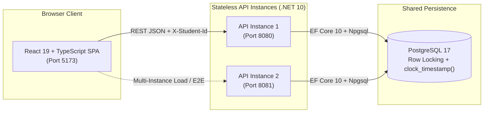
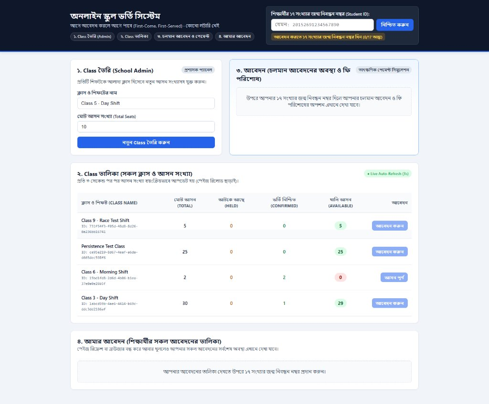
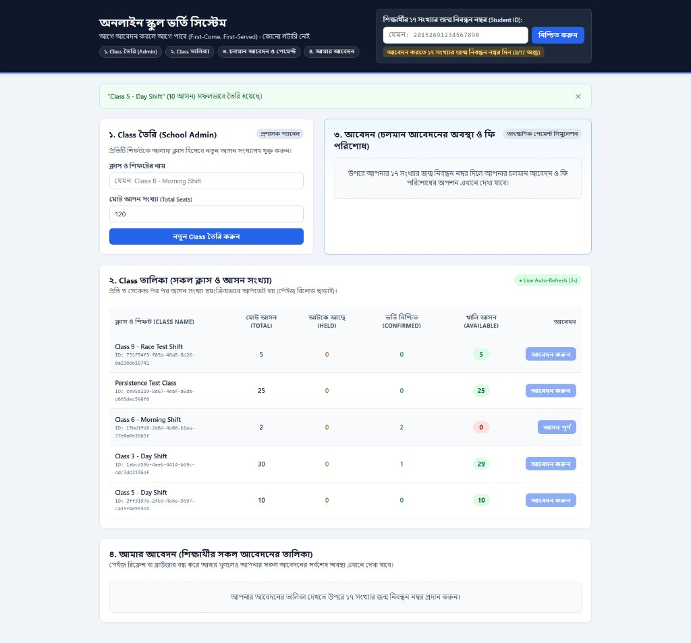
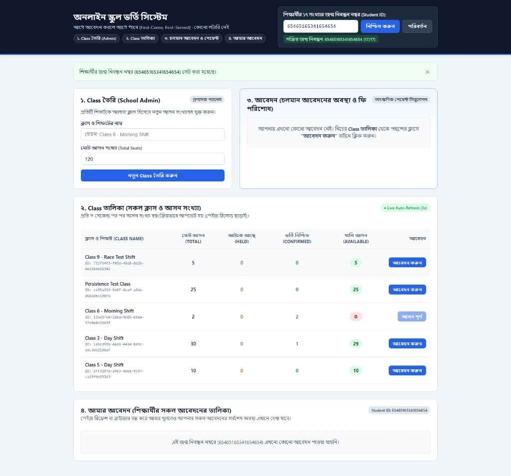
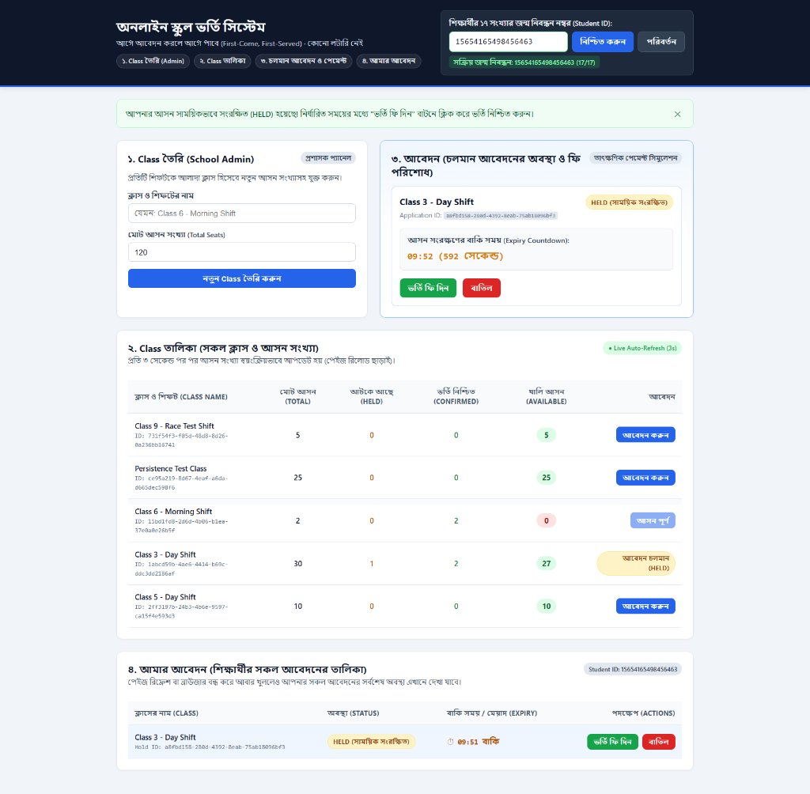
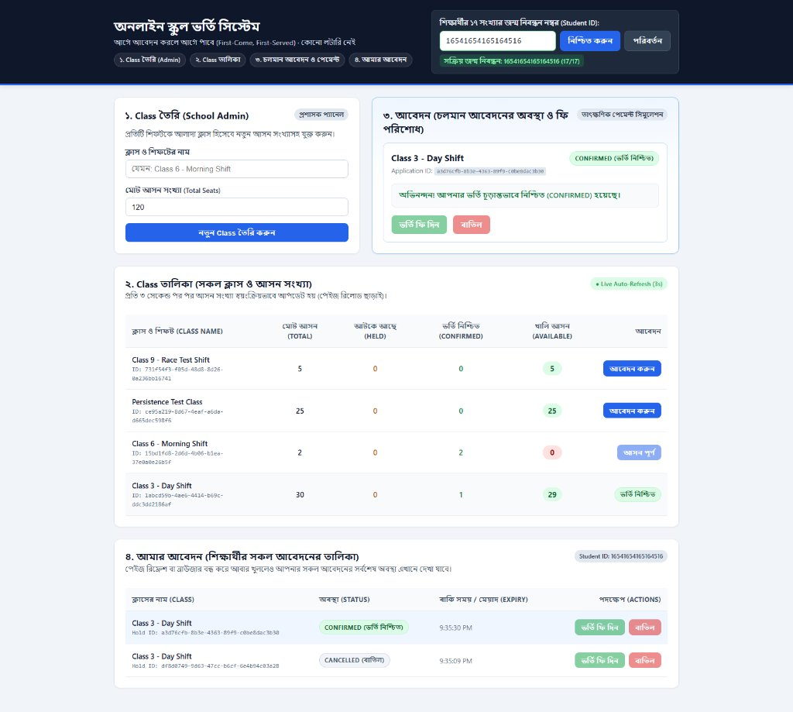
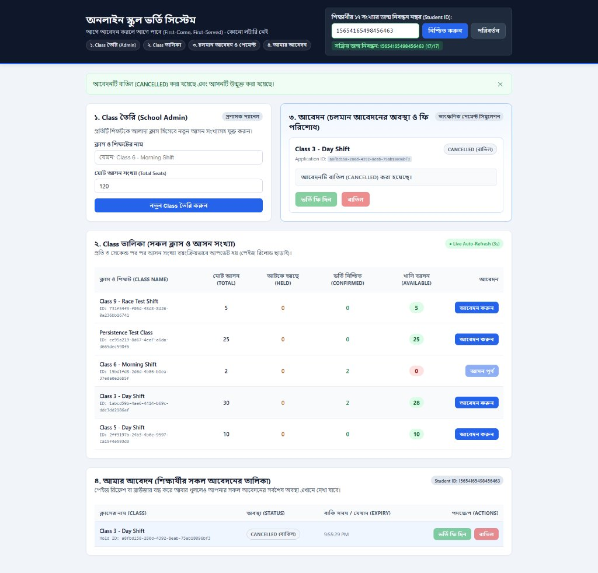

# Online School Admission System (অনলাইন স্কুল ভর্তি সিস্টেম)

A high-concurrency, first-come-first-served **Online School Admission System** built with **.NET 10 (ASP.NET Core Web API)**, **PostgreSQL 17**, and **React 19 + TypeScript**.

When admission opens, thousands of guardians attempt to reserve limited seats across classes and shifts simultaneously. This system guarantees **zero overbooking**, **strict per-student duplicate prevention**, **temporary seat holds with automatic expiration**, and **horizontal scalability across multiple backend instances** without relying on in-memory locks.

---

## Table of Contents

1. [Architecture Overview](#1-architecture-overview)
2. [Prerequisites](#2-prerequisites)
3. [Quick Start (Docker Compose)](#3-quick-start-docker-compose)
4. [Service URLs & Ports](#4-service-urls--ports)
5. [UI Walkthrough & Screenshots](#5-ui-walkthrough--screenshots)
6. [API Contract (All 8 Endpoints)](#6-api-contract-all-8-endpoints)
7. [Environment Variables](#7-environment-variables)
8. [Running Automated Integration & Concurrency Tests](#8-running-automated-integration--concurrency-tests)

---

## 1. Architecture Overview

The backend follows **Clean Architecture** split into four projects under `backend/src`, paired with an integration test suite under `backend/tests` and a single-page React portal under `frontend/`:



### Key Engineering Highlights
- **Multi-Instance Concurrency Safety:** All seat-mutating operations (`CreateHold`, `ConfirmHold`, `CancelHold`) serialize per class using PostgreSQL pessimistic row locking (`SELECT ... FROM admission_classes WHERE id = @classId FOR UPDATE`) in a consistent `Class -> Hold` lock order to prevent deadlocks.
- **Single Source of Time:** Write transactions evaluate PostgreSQL `SELECT clock_timestamp()` **after** acquiring row locks so time spent waiting on a lock is never ignored. Read queries and the background cleanup worker use database `now()`.
- **Defense-in-Depth Constraints:** A PostgreSQL partial unique index (`ux_admission_holds_active_student_per_class` on `(class_id, student_id) WHERE status IN ('HELD', 'CONFIRMED')`) guarantees at the storage engine level that a student can never hold or confirm more than one seat in the same class.
- **Safe Multi-Instance Migrations:** On startup, backend instances acquire a PostgreSQL session advisory lock (`pg_advisory_lock(7283940129384712)`) before running `Database.MigrateAsync()`, preventing race conditions when `api` and `api-2` boot simultaneously.

---

## 2. Prerequisites

- **Docker Desktop** (or Docker Engine + Docker Compose v2) — *required to run the full stack with a single command.*
- *(Optional for local non-Docker development)*:
  - **.NET 10 SDK** (`10.0.100` or later)
  - **Node.js 22+** and **npm**

---

## 3. Quick Start (Docker Compose)

From the root of the repository, build and start all services:

```bash
docker compose up --build
```

*(Or run in detached mode with `docker compose up -d --build`.)*

Docker Compose starts:
1. **`postgres`**: PostgreSQL 17 (`postgres:17-alpine`) configured with `max_connections=200` and a persistent volume (`pgdata`).
2. **`api`**: Primary ASP.NET Core 10 API instance on port **`8080`**.
3. **`api-2`**: Secondary ASP.NET Core 10 API instance on port **`8081`**, connected to the same PostgreSQL database to demonstrate horizontal scaling and cross-instance concurrency control.
4. **`frontend`**: React 19 production bundle served by Nginx on port **`5173`**, with runtime API URL injection via `/env-config.js`.

To stop the stack while keeping database data:
```bash
docker compose stop
```

To stop and remove containers (data remains in the `pgdata` volume unless `-v` is passed):
```bash
docker compose down
```

---

## 4. Service URLs & Ports

| Service | URL | Description |
| :--- | :--- | :--- |
| **Frontend Portal (UI)** | [http://localhost:5173](http://localhost:5173) | School Admin & Guardian Admission Portal |
| **Backend API (Instance 1)** | [http://localhost:8080](http://localhost:8080) | Primary REST API (`GET /health` for health check) |
| **Backend API (Instance 2)** | [http://localhost:8081](http://localhost:8081) | Secondary REST API sharing the same PostgreSQL DB |
| **PostgreSQL 17** | `localhost:5433` | Host port `5433` -> Container port `5432` (DB: `admission_db`; uses `postgres` / `postgres` as local assignment/demo defaults only) |

---

## 5. UI Walkthrough & Screenshots

The frontend ([http://localhost:5173](http://localhost:5173)) provides all four required workflows on a single responsive dashboard with Bengali labels, live 3-second seat polling, and a 1-second hold expiry countdown timer.

### 1. School Admin — Creating a Class (`১. Class তৈরি`)
Admins enter the class/shift name (e.g., `Class 5 - Day Shift`) and total seat capacity (`1–10,000`):



Once submitted, the class is immediately added to the live class table (`২. Class তালিকা`):



### 2. Student Identity — 17-Digit Birth Registration Number
Guardians enter the student's 17-digit numeric Birth Registration Number in the top bar. It is validated (`^\d{17}$`), persisted in `localStorage`, and can be changed anytime via the **পরিবর্তন** button:



### 3. Guardian — Applying for Admission & Live Countdown (`৩. আবেদন`)
Clicking **আবেদন করুন** reserves a seat (`HELD`), increments `Held` seats, decrements `Available` seats, and starts a real-time countdown timer with **ভর্তি ফি দিন** (Pay/Confirm) and **বাতিল** (Cancel) actions:



### 4. Payment Confirmation (`CONFIRMED`) & Application History (`৪. আমার আবেদন`)
Clicking **ভর্তি ফি দিন** permanently confirms the admission (`CONFIRMED`), updates the class's confirmed seat count, and records the status in **আমার আবেদন** (which persists across page reloads and browser restarts):



### 5. Hold Cancellation (`CANCELLED`) & Immediate Seat Release
Clicking **বাতিল** cancels the active hold (`CANCELLED`), disables the action buttons, and immediately releases the seat back to the available pool:



---

## 6. API Contract (All 8 Endpoints)

All endpoints accept and return JSON (`application/json`). Student-scoped endpoints require the `X-Student-Id` header containing a 17-digit numeric string (e.g., `20152691234567890`).

| # | Method | Path | `X-Student-Id` Required? | Success Status | Description |
| :--- | :--- | :--- | :---: | :---: | :--- |
| 1 | `POST` | `/classes` | No | `201 Created` | Create a new admission class/shift (`{ "name": "...", "totalSeats": 50 }`). |
| 2 | `GET` | `/classes` | No | `200 OK` | List all classes with `totalSeats`, `heldSeats`, `confirmedSeats`, and `availableSeats`. |
| 3 | `GET` | `/classes/{id}` | No | `200 OK` | Get real-time seat counts for a single class. |
| 4 | `POST` | `/classes/{id}/holds` | **Yes** | `201 Created` | Reserve a temporary seat (`HELD`) for the student in the specified class. |
| 5 | `GET` | `/holds/{id}` | No | `200 OK` | Get hold status (`HELD`, `CONFIRMED`, `EXPIRED`, `CANCELLED`) and `expiresAt`. |
| 6 | `POST` | `/holds/{id}/confirm` | **Yes** | `200 OK` | Confirm payment for an active hold (idempotent if already `CONFIRMED`). |
| 7 | `DELETE` | `/holds/{id}` | **Yes** | `204 No Content` | Cancel an active `HELD` application and release the seat immediately. |
| 8 | `GET` | `/me/holds` | **Yes** | `200 OK` | List all applications belonging to the student in `X-Student-Id`. |

### Standard Error Response Format
All `4xx` and `5xx` responses return a consistent JSON structure with a machine-readable `code`:
```json
{
  "code": "NO_SEATS",
  "message": "No seats are currently available in this class."
}
```
Common error codes (`ErrorCodes`):
- `400 Bad Request`: `INVALID_CLASS_NAME`, `INVALID_TOTAL_SEATS`, `MISSING_STUDENT_ID`, `INVALID_STUDENT_ID`, `INVALID_REQUEST`
- `403 Forbidden`: `FORBIDDEN_NOT_OWNER` (attempting to confirm/cancel another student's hold)
- `404 Not Found`: `CLASS_NOT_FOUND`, `HOLD_NOT_FOUND`
- `409 Conflict`: `DUPLICATE_CLASS_NAME`, `NO_SEATS`, `DUPLICATE_APPLICATION`, `HOLD_EXPIRED`, `HOLD_CANCELLED`, `HOLD_ALREADY_CONFIRMED`

---

## 7. Environment Variables

| Variable | Default in `docker-compose.yml` | Description |
| :--- | :--- | :--- |
| `ConnectionStrings__Default` | `Host=postgres;Port=5432;Database=admission_db;Username=postgres;Password=postgres` | PostgreSQL connection string for the backend API (`DATABASE_URL` URI format is also supported). |
| `HOLD_DURATION_SECONDS` | `600` (10 minutes) | Duration in seconds before an unconfirmed `HELD` seat automatically expires. |
| `MAX_POOL_SIZE` | `35` (`25` in `tests` container) | Npgsql maximum connection pool size per process when not explicitly set in the connection string. |
| `VITE_API_BASE_URL` | `http://localhost:8080` | Backend API base URL injected into `/env-config.js` at frontend container startup. |
| `POSTGRES_PORT` | `5433` | Host port mapped to container PostgreSQL port `5432`. |
| `FRONTEND_PORT` | `5173` | Host port mapped to container Nginx port `5173`. |

> **Security Note:** The default database credentials (`postgres` / `postgres`) in `docker-compose.yml` are provided strictly for zero-configuration local assignment evaluation and demo convenience. They are **not** production credentials; in any real deployment, credentials must be supplied via secure environment secrets.

---

## 8. Running Automated Integration & Concurrency Tests (and Frontend Build)

The test suite (`backend/tests/AdmissionSystem.IntegrationTests`) contains **6 comprehensive integration tests** covering:
1. **Single-Instance Concurrency:** 100 simultaneous requests for a 10-seat class -> exactly `10 × 201 Created` and `90 × 409 Conflict` (`NO_SEATS`).
2. **Two-Instance Concurrency (Bonus):** 100 simultaneous requests distributed across **two separate backend OS processes/containers** (`api` and `api-2`) sharing one PostgreSQL database -> exactly `10 × 201 Created` and `90 × 409 Conflict`.
3. **Hold Expiry & Seat Recovery:** Holds expire after `HOLD_DURATION_SECONDS`, seats return to `availableSeats`, late confirm returns `409 HOLD_EXPIRED`, and the same student can re-apply.
4. **Confirm vs. Cancel Race:** Concurrent `POST /holds/{id}/confirm` and `DELETE /holds/{id}` on the same hold resolve to exactly one winner with consistent final seat counts.
5. **Confirm vs. Expiry Boundary Race:** Confirming right at the expiry boundary never confirms an expired hold or corrupts seat counts.
6. **Edge Cases & Input Validation:** Idempotent double confirm (`200 OK`), duplicate active/confirmed application (`409 DUPLICATE_APPLICATION`), wrong student owner (`403 FORBIDDEN_NOT_OWNER`), unknown IDs (`404`), and invalid student IDs/payloads (`400`).

### Option A: Run All 6 Tests Inside Docker Compose (Recommended)
This starts `postgres`, `api`, and `api-2`, then runs the `tests` container against the live multi-container environment:

```bash
docker compose --profile test run --rm tests
```

### Option B: Run Tests Locally with `.NET 10 SDK`
When run locally, the test suite automatically provisions a PostgreSQL 17 container via Testcontainers (or uses `TEST_CONNECTION_STRING` if set) and spawns two real local backend OS processes for the two-instance concurrency test:

```bash
cd backend
dotnet test --logger "console;verbosity=normal"
```

### Option C: Verify Frontend TypeScript & Production Build Locally
To run the TypeScript compiler check (`tsc -b`) and Vite production bundle build (`vite build`) outside Docker:

```bash
cd frontend
npm ci
npm run build
```


